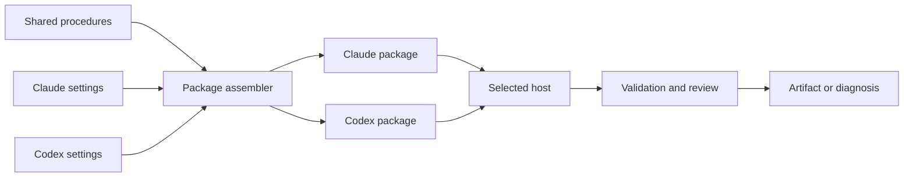

# Architecture

oh-my-cloud-skills is a Claude Code and Codex plugin marketplace with ten plugins.
It ships Markdown procedures and Python/Bash/Node helpers, with no application server.
Internal docs live in `docs/`; the public Docusaurus site lives in `doc-sites/`.

## Inventory

Counts below are derived from shared `skills/*/SKILL.md`, `commands/*.md`,
`agents/*.md`, generated `.codex-plugin/inventory.json`, and command hooks in each
Claude manifest (2026-10-22). Project-init uses convention-based source discovery.

| Plugin | Purpose | Source skills | Commands | Agents | Codex entries | Plugin hooks |
|---|---|---:|---:|---:|---:|---:|
| aws-content-plugin | Presentations, diagrams, documents, workshops | 9 | 0 | 9 | 18 | 6 |
| aws-ops-plugin | AWS infrastructure diagnosis and review | 6 | 0 | 10 | 16 | 2 |
| kiro-power-converter | Plugin to Kiro Power conversion | 1 | 0 | 1 | 2 | 1 |
| agentcore-creator | Agent design and AgentCore conversion/deployment | 1 | 0 | 1 | 2 | 1 |
| co-agent | Multi-AI review, decisions, ADRs and implementation workflows | 3 | 5 | 3 | 11 | 8 |
| project-init | Project scaffolding and documentation management | 1 | 10 | 1 | 12 | 0 |
| kiro | Host-planned implementation delegated to Kiro CLI | 1 | 4 | 1 | 6 | 5 |
| token-saver | Concise response guidance with complete work and required formats | 1 | 0 | 0 | 1 | 1 |
| pr-dash | PR checks and AI review status: Claude Code mod pane plus a text skill | 1 | 0 | 0 | 1 | 0 |
| agent-dash | Agent tree, estimated waits and an opt-in model policy: Claude Code mod plus a roster text skill | 1 | 0 | 0 | 1 | 0 |
| **Total** | | **25** | **19** | **26** | **70** | **24** |

The **70 source procedures** currently map to **70 Codex entry skills**. These are
separate inventories: same-name source aliases can share an entry. Specialist
entries are procedures, not native Codex agent roles.
The **24 plugin hook commands** exclude repository hooks and project-init's
separately installed project templates and the Claude Code mods of pr-dash and
agent-dash (`hooks/hooks.json` `modules`), which run in-process and are not command hooks. These counts do not measure CI review cells:
the default CI panel has one full-scope prompt and three enabled cells.

## Delivery and execution

- `hosts/catalog.json` owns shared identity and versions; `hosts/claude/` and
  `hosts/codex/` independently own execution configuration. Each plugin has
  self-contained packages under `packages/<host>/`. Registries are
  `.claude-plugin/marketplace.json` and `.agents/plugins/marketplace.json`.
  All share the release version and `v{version}` tag.
- `scripts/codex/` owns Codex adaptations. Generated entries link to procedure
  copies inside their installed package; edit the source or adapter and regenerate.
  Project-init's upstream source and repository-owned host configuration have separate
  ownership. See [host packaging](reference/host-packaging.md).
- Codex translates source tool/path conventions through its adapters. Hook execution
  requires supported events and actual trust; a manifest or installed file alone
  does not prove execution. Project-init templates need separate installation.
- In co-agent, the current host chairs and excludes itself from peer selection.
  Review/decide/ADR can fall back to solo with notice; consensus/harness require a
  READY peer with raw CLI access. Local optional hooks have their own opt-in and
  failure rules; they do not replace mandatory CI review.
  The canonical skill owns orchestration without a duplicate `co-agent` persona.
  Its three agents preserve distinct capabilities: `gate-chair` verifies
  findings, `pr-autofix-planner` produces read-only plans, and
  `pr-autofix-implementer` applies approved edits in an isolated worktree without
  Bash/network. `/co-agent:configure analyze [session-dir]` replaces the retired
  `harness-analyst` with host-run, advisory analysis; it never applies settings.
  [ADR-029](decisions/ADR-029-co-agent-role-consolidation.md) records the role
  consolidation and compatibility boundaries.
- Kiro delegation confines the diff landing in the main tree through worktree and
  scope checks. It does not sandbox arbitrary `execute_bash` inside that worktree;
  see the trust decision in `plugins/kiro/CLAUDE.md`.
- pr-dash and agent-dash are the plugins with a Claude Code mod: in-process
  JavaScript/TypeScript that draws a pane and status line. A mod is unsandboxed and
  Claude-only; the Codex package carries just a read-only skill (`pr-status`,
  `agent-status`). agent-dash is read-only toward the session except an opt-in
  `agent.spawn` model rewrite that a model named on the call or forced for the
  session overrides. Validate a mod with `claude plugin validate` and
  `claude plugin test` from its plugin directory.
- co-agent also ships one Claude-only dynamic workflow, `workflows/decision-reconcile-panel.js`,
  behind decision-reconcile's fast path. It is not counted as a skill, command or agent, and
  its Codex package excludes `workflows/`.

## Artifact and review boundaries

Content artifacts require the applicable content-review gate: normally 85/100,
or 77/90 when Visual Testing is exempt. Diagram and Remarp validation precede export
or build. Native editable PPTX uses `aws-light-fcd`; web-deck PPTX export captures
slide images. Both use the shared icon library. Archify diagrams embed through
Remarp's `:::archify` path ([ADR-020](decisions/ADR-020-archify-interactive-diagrams.md)).
Mixed changes require every applicable gate in [review routing](reference/review-routing.md).
AWS security mandates remain binding even when an implementation differs from them.

PR acceptance requires a review of the latest HEAD, no unresolved Critical/Major
findings, and all required checks. The semantic review gate validates final Issues;
the chair, informed of any degraded coverage before it decides, judges whether that
gap still permits PASS ([ADR-026](decisions/ADR-026-chair-decides-on-degraded-coverage.md)).
A lexical `VERDICT: PASS`, a missing review, or a local hook's fail-open result
cannot establish acceptance.

Privileged `pull_request_target` review executes trusted base scripts and treats the
PR tree as data. Separate [Codex package validation](../.github/workflows/codex-validation.yml)
checks the PR HEAD's generator, generated output, manifests and inventory in isolated
CI. It must pass alongside AI review; generation freshness has no plugin exemption.
See [ADR-021](decisions/ADR-021-english-docs-current-review-authority.md) for authority
and historical ADR scope, and [runtime verification](reference/codex-runtime-verification.md)
for evidence beyond static validation.

## Maintenance

[Onboarding](onboarding.md) lists validation commands; host/hook changes also need
runtime checks. Keep maintained internal docs concise and English. User artifact language and
functional literals remain independent. Read scoped `CLAUDE.md` files before editing.
