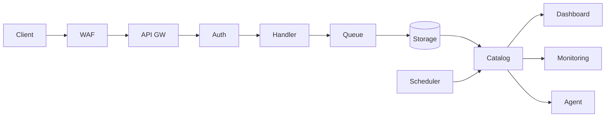

# Documentation Templates

Templates for `docs/` files. Bilingual layout, tone, formatting, and Mermaid diagram rules come from `writing-style-guide.md` in this directory; each template below adds only the structure specific to its document.

---

## Architecture Document

Path: `docs/architecture.md`

`docs/architecture.md` describes components that exist in the repo, grouped by the Layer Categories below (only the layers that apply), with a full `flowchart TB` diagram, a `flowchart LR` Data Flow Summary of the critical path, infrastructure resources in tables when IaC is present, and Key Design Decisions that say why. Omit a section whose condition is not met, such as Infrastructure without IaC or Operations without runbooks, instead of leaving placeholders in it.

### Template Structure

````markdown
# Architecture

<a href="#english"></a>
<a href="#korean"></a>

---

<a id="english"></a>

# English

## System Overview

<project_name> is <brief_architecture_description>.
<key_technology_summary>.
<primary_data_flow_summary>.

## Components

### <Layer Name> Layer
- **<directory/>** -- <description>. <key detail>.
- **<directory/>** -- <description>. <key detail>.

## Full Architecture Diagram

```mermaid
flowchart TB
  subgraph <layer_id>[<Layer Name>]
    <A>[<Component>] --> <B>[<Component>]
  end
```

## Data Flow Summary

```mermaid
flowchart LR
  <Entry> --> <Step> --> <Store>[(<Store>)]
```

## Infrastructure

### Deployment Region
- <region> (<location>)

### Modules / Resources
| Module | Resources | Description |
|--------|-----------|-------------|
| <module> | <resources> | <description> |

### Deployed Resources
- <endpoint_name>: `<url_pattern>`

## Key Design Decisions

- <What was decided> -- <Why this choice was made over the alternatives>

## Operations
- <Runbook title>: see [docs/runbooks/<name>.md](runbooks/<name>.md)

---

<a id="korean"></a>

# 한국어

## 시스템 개요

<프로젝트 이름>은 <아키텍처 요약>입니다.
<핵심 기술 요약>.
<주요 데이터 흐름 요약>.

## 구성 요소

### <계층 이름> 계층
- **<directory/>** -- <설명>. <핵심 세부 사항>.
- **<directory/>** -- <설명>. <핵심 세부 사항>.

## 전체 아키텍처 다이어그램

```mermaid
flowchart TB
  subgraph <layer_id>[<Layer Name>]
    <A>[<Component>] --> <B>[<Component>]
  end
```

## 데이터 흐름 요약

```mermaid
flowchart LR
  <Entry> --> <Step> --> <Store>[(<Store>)]
```

## 인프라

### 배포 리전
- <region> (<위치>)

### 모듈 / 리소스
| 모듈 | 리소스 | 설명 |
|------|--------|------|
| <module> | <resources> | <설명> |

### 배포된 리소스
- <endpoint_name>: `<url_pattern>`

## 주요 설계 결정

- <결정 내용> -- <다른 대안 대신 이 방식을 택한 이유>

## 운영
- <런북 제목>: [docs/runbooks/<name>.md](runbooks/<name>.md) 참조
````

- Components: one bullet per directory or service that exists; the layer names come from the Layer Categories table.
- Operations: link only runbooks that exist in `docs/runbooks/`, and omit the section when there are none, because a link to a runbook that was never written sends an operator nowhere during an incident.

### Layer Categories

Organize components into these standard layers (use only the layers that apply):

| Layer | Purpose | Example Components |
|-------|---------|-------------------|
| Ingestion Layer | Data entry points | SDKs, API Gateway, Lambda handlers, message queues |
| Storage Layer | Data persistence | S3, RDS, DynamoDB, Firehose, cache |
| Processing Layer | Data transformation | ETL Lambdas, Step Functions, batch jobs |
| Query Layer | Data access | Athena, Glue, search indices |
| Presentation Layer | User interfaces | Frontend apps, dashboards, Grafana |
| Observability Layer | Monitoring | CloudWatch, alarms, logging |
| Security Layer | Auth and protection | WAF, IAM, Cognito, secrets management |
| AI/ML Layer | Intelligence | Bedrock, SageMaker, agent systems |

### Diagrams

Direction, subgraphs, node shapes, English labels, and identical diagrams in both halves follow the writing-style-guide Diagram Rules. What an architecture document adds:

- The full diagram has one `subgraph` per layer from the Layer Categories table, with the same names as the Components section.
- Put key details in node labels where they matter: ports, protocols, formats (for example `APIGW[API Gateway HTTPS 443]`).
- The Data Flow Summary is the critical path only, as one left-to-right chain with branches where the path forks:



### Key Design Decisions Style

Each decision explains why, not only what:

- Good: "Use Firehose as buffer to support high throughput without Lambda throttling"
- Bad: "Use Kinesis Firehose"

Format: `<What was decided> -- <Why this choice was made over alternatives>`. Link the ADR when one exists.

---

## ADR Template

Path: `docs/decisions/.template.md`

Numbering: the highest existing number plus one, as `ADR-NNN-concise-title.md` (for example `ADR-001-use-postgresql.md`).

```markdown
# ADR-000: Title

<a href="#english"></a>
<a href="#korean"></a>

---

<a id="english"></a>

# English

## Status
Proposed | Accepted | Deprecated | Superseded

## Context
<!-- The problem and the forces behind it, not the chosen solution -->

## Options Considered

### Option 1: <Name>
- **Pros**: <advantages>
- **Cons**: <disadvantages>

### Option 2: <Name>
- **Pros**: <advantages>
- **Cons**: <disadvantages>

## Decision
<!-- The chosen option and why it won over the others -->

## Consequences

### Positive
- <positive impact>

### Negative
- <negative impact or trade-off>

## References
- <links to relevant docs, issues, or discussions>

---

<a id="korean"></a>

# 한국어

## 상태
제안됨 | 승인됨 | 더 이상 사용되지 않음 | 대체됨

## 배경
<!-- 선택한 해법이 아니라, 해결해야 할 문제와 그 배경 -->

## 검토한 옵션

### 옵션 1: <이름>
- **장점**: <이점>
- **단점**: <단점>

### 옵션 2: <이름>
- **장점**: <이점>
- **단점**: <단점>

## 결정
<!-- 선택한 옵션과 다른 옵션 대신 선택한 이유 -->

## 영향

### 긍정적
- <긍정적 영향>

### 부정적
- <부정적 영향 또는 트레이드오프>

## 참고 자료
- <관련 문서, 이슈, 또는 논의 링크>
```

---

## Runbook Template

Path: `docs/runbooks/.template.md`

```markdown
# Runbook: Title

<a href="#english"></a>
<a href="#korean"></a>

---

<a id="english"></a>

# English

## Overview
<!-- Purpose of this runbook -->

## When to Use
<!-- Circumstances that trigger this runbook -->

## Prerequisites
<!-- Required permissions, tools, access -->

## Procedure

### 1. <First Phase>
<!-- Copy-paste ready commands; after each state change, a command that shows it worked -->

### 2. <Second Phase>
<!-- Copy-paste ready commands; after each state change, a command that shows it worked -->

## Verification
- [ ] <check 1>
- [ ] <check 2>

## Rollback
<!-- Commands that undo each state-changing step; say which steps cannot be undone -->

## Notes
- Last verified: <!-- YYYY-MM-DD of the last real run, or "not yet run" -->

---

<a id="korean"></a>

# 한국어

## 개요
<!-- 이 런북의 목적 -->

## 사용 시점
<!-- 이 런북을 따라야 하는 상황 -->

## 사전 요구 사항
<!-- 필요한 권한, 도구, 접근 권한 -->

## 절차

### 1. <첫 번째 단계>
<!-- 복사-붙여넣기 가능한 명령어; 상태를 바꾼 뒤마다 결과를 확인하는 명령어 -->

### 2. <두 번째 단계>
<!-- 복사-붙여넣기 가능한 명령어; 상태를 바꾼 뒤마다 결과를 확인하는 명령어 -->

## 검증
- [ ] <확인 1>
- [ ] <확인 2>

## 롤백
<!-- 상태를 바꾼 각 단계를 되돌리는 명령어; 되돌릴 수 없는 단계는 명시 -->

## 참고
- 최종 검증일: <!-- 마지막으로 실제 실행한 날짜(YYYY-MM-DD) 또는 "아직 실행 안 함" -->
```

- Notes: `Last verified` records the last time someone ran the procedure end to end, not the date the runbook was written, because an operator trusts a dated line as proof that the commands work.

### Recommended Runbooks

| Runbook | When to Create |
|---------|---------------|
| `deploy-production.md` | Project has Dockerfile, CDK, SAM, Terraform, or CI/CD |
| `database-migration.md` | Project has migration files or database config |
| `incident-response.md` | Project has monitoring or alerting config |
| `environment-setup.md` | Project has multiple environments |
| `rollback-production.md` | Production deployment runbook exists |

---

## Onboarding Document

Path: `docs/onboarding.md`

```markdown
# Developer Onboarding

## Quick Start

### 1. Prerequisites
<!-- Required tools, accounts, and access -->
- [ ] <tool/runtime> installed (version X+)
- [ ] Repository access granted
- [ ] Environment variables configured (see .env.example)

### 2. Setup
<!-- Step-by-step setup with copy-paste commands -->

### 3. Verify
<!-- How to confirm everything works -->

## Project Overview
<!-- Brief architecture explanation for newcomers -->
- Read `CLAUDE.md` for project context and conventions
- Read `docs/architecture.md` for system design
- Review `docs/decisions/` for architectural decisions

## Development Workflow
<!-- Day-to-day process as this repo actually runs it: branch naming, commit convention (see git log and any commit-msg hook), PR process. Leave out what the repo does not show. -->

## Key Concepts
<!-- Domain-specific concepts new developers need to know -->

## Troubleshooting
<!-- Common issues new developers encounter -->

## Resources
<!-- Links to relevant documentation, wikis, design docs -->
```

---

## API Reference Document

Path: `docs/api-reference.md`

````markdown
# API Reference

## Base URL
<!-- e.g., https://api.example.com/v1 -->

## Authentication
<!-- How to authenticate (Bearer token, API key, etc.) -->

## Endpoints

### <Resource Name>

#### List <Resources>
```http
GET /resources
```

| Parameter | Type | Required | Description |
|-----------|------|----------|-------------|
| `page` | integer | No | Page number (default: 1) |
| `limit` | integer | No | Items per page (default: 20) |

**Response** `200 OK`

#### Get <Resource>
```http
GET /resources/:id
```

**Response** `200 OK`

#### Create <Resource>
```http
POST /resources
```

**Request Body**

| Field | Type | Required | Description |
|-------|------|----------|-------------|
| `name` | string | Yes | Resource name |

**Response** `201 Created`

## Error Codes

| Code | Description |
|------|-------------|
| 400 | Bad Request - Invalid parameters |
| 401 | Unauthorized - Missing or invalid auth |
| 403 | Forbidden - Insufficient permissions |
| 404 | Not Found - Resource does not exist |
| 500 | Internal Server Error |

## Rate Limits
<!-- Rate limiting policy -->
````

---

## Environment Template

Path: `.env.example`

```bash
# Application
APP_NAME=my-app
APP_ENV=development
APP_PORT=3000

# Database
DB_HOST=localhost
DB_PORT=5432
DB_NAME=myapp_dev
DB_USER=
DB_PASSWORD=

# Authentication
JWT_SECRET=
JWT_EXPIRY=3600

# External Services
# API_KEY=
# WEBHOOK_URL=
```

### Rules

- `.env.example` is committed to git and contains only placeholder values
- `.env` is never committed; it is listed in `.gitignore` because it holds real secrets
- Secrets use empty values or comments in `.env.example`
- Each variable includes a comment explaining its purpose
- Only variables the project's code reads belong here. `CLAUDE_NOTIFY_WEBHOOK` for the optional notify.sh hook does not: the hook reads it from the environment, never from `.env`, so its Configure note in `hook-scripts.md` is the one place that says where to set it.
