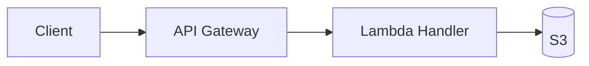

# README Template

Structure for bilingual (English/Korean) `README.md` files following GitHub open-source practice. Bilingual layout, tone, formatting, and Mermaid rules come from `writing-style-guide.md` in this directory; this file adds only what is specific to a README.

---

## Auto-Detection Sources

Fill each field from these sources before asking the user.

| Field | Detection Source |
|-------|-----------------|
| Project name | Directory name, manifest `name` field, existing README h1 |
| Description | Manifest `description` field, existing README |
| Tech stack | File extensions, manifest dependencies, `CLAUDE.md` tech stack |
| License | `LICENSE` file, manifest `license` field |
| Version | Manifest `version` field, git tags |
| Prerequisites | Manifest `engines` field, `.tool-versions`, Dockerfile base image |
| Install command | Manifest `scripts.install`, `Makefile install` target |
| Test command | Manifest `scripts.test`, `Makefile test` target |
| Configuration | `.env.example`, `.env.sample` |
| Build status | CI config (`.github/workflows/`, `.gitlab-ci.yml`, `Jenkinsfile`, `.circleci/config.yml`) |
| Repository URL | `git remote get-url origin` |

---

## Top Layout

The file starts with the project name, the badge line, and a one-line description in both languages, then the first `---`. The English and Korean halves follow as the style guide lays them out.

```markdown
# <Project Name>

[](LICENSE)
[](CHANGELOG.md)
<a href="#english"></a>
<a href="#korean"></a>

<English one-line description> | <Korean one-line description>

---
```

- License and version values come from the project. Leave out a badge you cannot fill rather than showing a placeholder.
- Add a build status badge only when CI config is detected.
- Link the version badge to `CHANGELOG.md` when it exists, otherwise to the repository's releases page.

---

## Section Structure

Apply these sections in order within each language half. Omit a conditional section when its condition is not met.

| Order | English Heading | Korean Heading | Condition |
|-------|----------------|----------------|-----------|
| 1 | ## Overview | ## 개요 | Required |
| 2 | ## Features | ## 주요 기능 | Required |
| 3 | ## Architecture | ## 아키텍처 | Recommended |
| 4 | ## Prerequisites | ## 사전 요구 사항 | Required |
| 5 | ## Installation | ## 설치 방법 | Required |
| 6 | ## Usage | ## 사용법 | Required |
| 7 | ## Configuration | ## 환경 설정 | When env vars exist |
| 8 | ## Project Structure | ## 프로젝트 구조 | Recommended |
| 9 | ## Testing | ## 테스트 | When tests exist |
| 10 | ## API Documentation | ## API 문서 | When API exists |
| 11 | ## Contributing | ## 기여 방법 | Required |
| 12 | ## License | ## 라이선스 | Required |
| 13 | ## Contact | ## 연락처 | Required |

---

## Section Guidelines

### Overview / 개요
- 2-3 sentences on the project's purpose and the problem it solves
- Insert the demo image or GIF here if one was provided

### Features / 주요 기능
- Format: `- **Feature name** — Description` (em-dash `—` between name and description)
- 3-5 key features, each saying what it does rather than marketing language

### Architecture / 아키텍처
- A Mermaid flowchart of the critical path: `flowchart LR` for a simple chain, `flowchart TB` with one `subgraph` per layer when layers matter
- When `docs/architecture.md` exists, derive the flowchart from its Data Flow Summary and link the document, so the summary and the full document agree. Otherwise draw the critical path from the code: entry point, processing, storage or output
- Roughly 5-10 nodes; this is a summary, not the full diagram



### Prerequisites / 사전 요구 사항
- Required runtimes, tools, and minimum versions, as a bulleted list

### Installation / 설치 방법
- Step-by-step commands in a bash code block, with a comment per step
- Clone, install dependencies, and build if applicable

```bash
# Clone the repository
git clone https://github.com/<user>/<repo>.git
cd <repo>

# Install dependencies
<install_command>
```

### Usage / 사용법
- Basic usage examples in code blocks, with expected output as comments where possible
- Start with the simplest use case, then show advanced options

### Configuration / 환경 설정
- Environment variables in a table

| Variable | Description | Default |
|----------|-------------|---------|
| `VAR_NAME` | What it controls | `default_value` |

### Project Structure / 프로젝트 구조
- A tree in a `text` code block with only the most important directories and files, not an exhaustive listing
- The tree is the same in both halves; only the comments are translated (in the Korean half: `# 소스 코드`, `# 테스트 파일`, `# 문서`)

```text
project-root/
  src/           # Source code
  tests/         # Test files
  docs/          # Documentation
```

### Testing / 테스트
- Commands for running tests, coverage, and a single test file, in bash code blocks

### API Documentation / API 문서
- A brief overview of the endpoints or API surface, with a link to detailed API docs if they exist

### Contributing / 기여 방법
- When `CONTRIBUTING.md` exists, or the repository is private or internal: describe the project's actual branch and pull request flow and link `CONTRIBUTING.md` if it exists
- Otherwise (a public GitHub repository): the fork flow below, with a Conventional Commits example

```markdown
1. Fork the repository
2. Create your branch (`git checkout -b feat/amazing-feature`)
3. Commit changes (`git commit -m 'feat: add amazing feature'`)
4. Push to the branch (`git push origin feat/amazing-feature`)
5. Open a Pull Request
```

### License / 라이선스
- The license name and a link to the LICENSE file

### Contact / 연락처
- The maintainer's GitHub profile link, the issues page link, and an email if one was provided

---

## Update Rules

When updating an existing README.md, the user's own writing is the reason to update rather than regenerate:

1. **Preserve** user-written content that doesn't conflict with the template structure
2. **Merge** new auto-detected information with existing content
3. **Reorder** sections to match the standard order if they are out of order
4. **Add** missing required sections
5. **Keep** additional custom sections the user added, placed after the standard sections
6. **Update** badges to reflect the current version and license
7. **Sync** both language halves so they contain the same information
8. **Report** a `check-bilingual.py` issue inside the user's own prose that existed before this update (an emoji, an untagged code fence) as pre-existing instead of rewriting that prose
