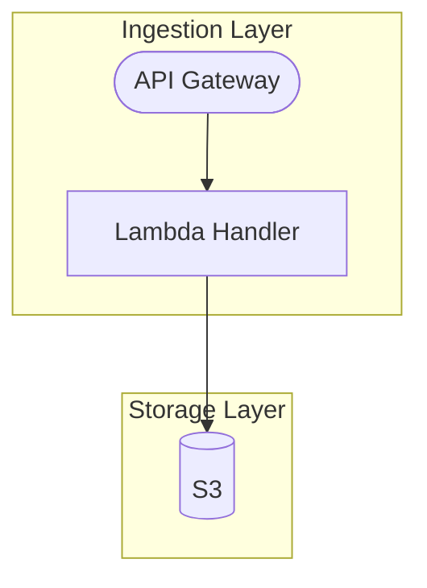

# Writing Style Guide

Rules for every bilingual document the plugin writes: `README.md`, `CHANGELOG.md`, `docs/architecture.md`, ADRs (`docs/decisions/`), runbooks (`docs/runbooks/`), and implementation reference docs (`docs/reference/*.md` and `docs/reference/INDEX.md`). Per-document templates add the structure of their document type; where one disagrees with this guide on style or layout, this guide wins.

---

## Bilingual Structure

```markdown
# <Document Title>

<a href="#english"></a>
<a href="#korean"></a>

---

<a id="english"></a>

# English

<all English sections>

---

<a id="korean"></a>

# 한국어

<all Korean sections>
```

### Rules

- The English half comes first and the Korean half second (ADR-001).
- The two badges are the HTML tags shown above, on one line or two, between the title and the first `---`. Do not use Markdown badges (`[](#...)`), because GitHub may render them as a bare image that opens the SVG instead of jumping to the anchor (ADR-002).
- Anchor IDs are ASCII-only, `english` and `korean`, because Unicode anchors such as `#한국어` break with browser URL encoding. `<a id="english"></a>` and `<a id="korean"></a>` each sit on their own line directly above `# English` and `# 한국어`.
- A `---` line separates the badges from the English half, and the English half from the Korean half.
- Both halves have the same sections in the same order, at the same heading levels, with the same information, because a section missing from one half is how an incomplete update shows up (ADR-001).
- Code blocks, tables, commands, and directory trees appear in both halves. Translate only descriptive text, including comments inside code blocks and descriptive table cells; code, commands, file paths, technical terms, and proper nouns stay unchanged.

---

## Writing Style

### Length (Both Languages)

- Write what the reader of this document type needs, then stop; every sentence appears in both languages, so padding costs double.
- Omit an optional section whose condition is not met instead of filling it with a placeholder or generic text.
- Do not restate the introduction, summarize the document at its end, or add boilerplate advice.

### English

- Use imperative mood: "Run the following command", "Add the configuration"
- Start changelog/list entries with an imperative verb: "Add feature", "Fix bug"

### Korean

- Use 경어체 (~합니다): "다음 명령어를 실행합니다", "설정을 추가합니다"
- Changelog/list entries use 명사형 종결: "기능 추가", "버그 수정"

---

## Formatting Rules

### Prohibited

- No emoji anywhere, code blocks and diagrams included
- No marketing language or vague descriptions ("various improvements", "miscellaneous fixes")
- No filler phrases ("In order to", "It should be noted that")

### Required

- Every code block names its language (```text for plain output and directory trees), because the checker reports untagged fences
- Badges use shields.io
- Dates use ISO 8601 (YYYY-MM-DD)
- File paths and commands are copy-paste ready
- Tables use Markdown pipe syntax

### Headings

- h1 for the document title and the two language headings, h2 for major sections, h3 for subsections

---

## Diagram Rules

All architecture flows and diagrams use **Mermaid flowchart** inside fenced ```mermaid code blocks, not ASCII box diagrams (`┌─┐│└─┘▶▼` characters), because GitHub renders Mermaid and a diff shows each change.

### Direction and Structure

- **Layered architecture diagrams**: `flowchart TB` with one `subgraph` per architectural layer
- **Data flow / critical path**: `flowchart LR` as a single left-to-right chain
- Group related components with `subgraph <id>[<Layer Name>]`; keep one component per node
- Use node shapes meaningfully: `[Component]` for services/processes, `[(Store)]` for databases/storage, `([Entry Point])` for external entry points

### Labels and Bilingual Handling

- Node and edge labels stay in English in both language halves; only surrounding prose is translated
- Diagrams are byte-identical in the English and Korean halves

### Example



---

## Bilingual Sync Validation

After writing or updating a bilingual document, run the checker on it:

```bash
python3 ${CLAUDE_PLUGIN_ROOT}/scripts/check-bilingual.py <file>
```

`${CLAUDE_PLUGIN_ROOT}` is the plugin directory: the path you read this guide from, without `/skills/project-scaffolder/references/writing-style-guide.md`.

It prints one `FILE:LINE: message` line per problem and exits 0 when clean, 1 on problems, and 2 when it could not read a file. Fix what it reports in the text you wrote and run it again. Leave an issue in content that existed before this run (a released CHANGELOG section, the user's own README prose) and report it as pre-existing, because the templates' Update Rules keep that content unchanged. If a report looks wrong, leave the text and say so in your report. Without python3, say "checker unavailable" in your report and check the rules above by reading.

The checker cannot judge meaning, so then read both halves: each Korean paragraph says what its English counterpart says, no descriptive text is left untranslated, and technical terms and proper nouns are written the same way in both.
