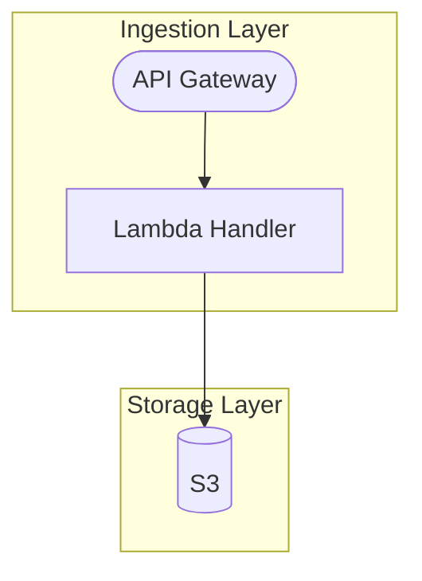

# Writing Style Guide

Rules for every document the plugin writes. `README.md`, `CHANGELOG.md`, `docs/architecture.md`, ADRs (`docs/decisions/`), runbooks (`docs/runbooks/`), and implementation reference docs (`docs/reference/*.md` and `docs/reference/INDEX.md`) are bilingual. A document kept in one language, such as a single-language README or `docs/onboarding.md`, follows every section except `## Bilingual Structure` and `## Bilingual Sync Validation`. Per-document templates add the structure of their document type; where one disagrees with this guide on style or layout, this guide wins.

---

## Bilingual Structure

```markdown
# <Document Title>

<a href="#english"></a>
<a href="#korean"></a>

---

<a id="english"></a>

# English

<all English sections>

---

<a id="korean"></a>

# 한국어

<all Korean sections>
```

### Rules

- The English half comes first and the Korean half second (ADR-001).
- The two badges are the HTML tags shown above, on one line or two, between the title and the first `---`. Do not use Markdown badges (`[](#...)`), because GitHub may render them as a bare image that opens the SVG instead of jumping to the anchor (ADR-002).
- Anchor IDs are ASCII-only, `english` and `korean`, because Unicode anchors such as `#한국어` break with browser URL encoding. `<a id="english"></a>` and `<a id="korean"></a>` each sit on their own line directly above `# English` and `# 한국어`.
- A `---` line separates the badges from the English half, and the English half from the Korean half.
- A link to a section of the same document points at an explicit ASCII anchor, not at the heading: put `<a id="<name>-en"></a>` on its own line above the English heading and `<a id="<name>-ko"></a>` above the Korean one, and link to `#<name>-en` or `#<name>-ko`. The anchor GitHub derives from a Korean heading is Unicode and breaks the way `#한국어` does (ADR-002).
- Both halves have the same sections in the same order, at the same heading levels, with the same information, because a section missing from one half is how an incomplete update shows up (ADR-001).
- Code blocks, tables, commands, and directory trees appear in both halves. Translate only descriptive text, including comments inside code blocks and descriptive table cells; code, commands, file paths, technical terms, and proper nouns stay unchanged.

---

## Writing Style

The reader opens a document to do something: install, run, decide, or fix. Write so that they find what they need on the first read. These rules apply to the text a command writes in this run, in English and in Korean alike.

- They never remove a fact. Every number, command, path, condition, and warning in the source stays, and a sentence that carries one is rewritten instead of deleted.
- Prose the user wrote and released CHANGELOG sections stay as they are, because an update fixes content and leaves the author's style alone. Rewrite existing prose for style only when the user asks, and then these rules cover the whole document.

### Length (Both Languages)

- Write what the reader of this document type needs, then stop; every sentence appears in both languages, so padding costs double.
- Omit an optional section whose condition is not met instead of filling it with a placeholder or generic text.
- Do not restate the introduction, summarize the document at its end, or add boilerplate advice.

### Readability (Both Languages)

- Put the point first. A section opens with what the thing is or what the reader does, and background follows, because readers decide from the first line whether to keep reading.
- Keep one idea in a sentence. Split a sentence that joins three or more clauses, or that runs past about 30 words in English or 70 characters in Korean.
- Name the actor and use an active verb: "The hook blocks the commit" for "The commit is blocked". Use the passive only when the actor is unknown or does not matter.
- Prefer the concrete. Give a number, a command, a file path, or an example where an adjective would go: "finishes in 2 seconds" for "fast".
- Use one term for one thing. After a component is called a "hook", do not call it a "script" or a "handler" later, and keep the term the same in both languages, because a new word reads as a new thing.
- Choose the form by the content: numbered steps for a procedure followed in order, a table for items compared on the same attributes, a list for parallel items, and paragraphs for reasoning. Do not cut connected reasoning into bullets or put a single fact in a table.
- Keep a paragraph to one topic and about four sentences, and a list item to one or two sentences. Longer content becomes a paragraph or a subsection.
- A heading names what its section holds, as a short noun phrase a reader can scan ("Installation", "Rollback"). No questions and no slogans.
- Explain an abbreviation or a project term where it first appears, and link to the place that defines a thing instead of explaining it again.

### No AI Slop (Both Languages)

AI slop is wording that carries no information and marks a text as machine-written. A reader who spots it starts to skim and trusts the rest less. Keep these patterns out of the text you write:

- Openers and closers. No sentence that announces, praises, or welcomes ("This guide walks you through", "이 문서에서는 설정을 살펴보겠습니다"), and no closing summary, wish, or offer ("Happy coding!", "도움이 되셨길 바랍니다"). Start with the content and stop when it ends.
- Unsupported praise: "powerful", "seamless", "robust", "혁신적인", "강력한", "완벽한". Replace the word with the number or fact that backs it, or delete the word.
- Inflated importance: "plays a crucial role", "is a testament to", "매우 중요한 역할을 합니다", "주목할 만합니다". Say what the thing does.
- Contrast for effect: "It is not just X, it is Y", "X가 아니라 Y입니다". State Y. Keep a contrast only where the reader would otherwise assume X.
- Groups of three for rhythm. List as many items as there are.
- Staged build-up and punch lines: "Here's the thing:", "The result?", "And that changes everything.", "그 결과는 어땠을까요?", "이것이 핵심입니다." Say the point in a plain sentence.
- Hedging. State a checked fact as a fact and mark a guess as a guess, once. Do not add "can", "may", or "~할 수 있습니다" to something that always happens, and do not stack hedges ("could potentially").
- Saying it twice. No sentence that repeats the one before it in other words, and no "in other words", "즉", or "다시 말해" followed by the same content.
- Statements that fit any project: "improves developer productivity", "개발 생산성을 높여 줍니다". Write what this project does, or delete the sentence.
- Symbols in place of words. Do not join ideas in a sentence with an em dash, an arrow, a middle dot, or a slash; write the relation out ("A, then B", "A와 B"). Code, paths, commands, short table cells, and a separator a template prescribes (`- **Name** -- Description`) are exempt.
- Decoration. Use bold only for a term the reader scans for, such as the name that starts a list item or a UI label, and never for emphasis inside a sentence.

### English

- Use imperative mood: "Run the following command", "Add the configuration"
- Start changelog/list entries with an imperative verb: "Add feature", "Fix bug"
- Use the plain word: "use" for "utilize" or "leverage", "help" for "facilitate", "is" for "serves as", "to" for "in order to", "because" for "due to the fact that"
- Leave out words that add nothing when you ask what they tell the reader: "delve", "streamline", "effortless", "unlock", "cutting-edge", "game-changing", "it is worth noting that", "it is important to note that", "in conclusion"
- Do not put "simply", "just", or "easily" before an instruction, because a reader who is stuck does not find it simple

### Korean

- Use 경어체 (~합니다): "다음 명령어를 실행합니다", "설정을 추가합니다"
- Changelog/list entries use 명사형 종결: "기능 추가", "버그 수정". A sentence in a paragraph ends with a verb
- Fix 번역투 (translationese) with particles and active verbs:

| Avoid | Write |
|---|---|
| `설정에 대해 설명합니다` | `설정을 설명합니다` |
| `검증에 있어서 속도가 중요합니다` | `검증은 속도가 중요합니다` |
| `배포와 관련하여 확인할 사항` | `배포할 때 확인할 사항` |
| `옵션을 세 개 가지고 있습니다` | `옵션이 세 개 있습니다` |
| `판단되어집니다` | `판단됩니다` |
| `커밋이 훅에 의해 차단됩니다` | `훅이 커밋을 막습니다` |
| `스크립트를 통해 검사를 실행합니다` | `스크립트로 검사합니다` |
| `캐시를 지울 수 있습니다`, when it always does | `캐시를 지웁니다` |
| `프로젝트의 설정의 변경` | `프로젝트 설정 변경` |

- Leave out stock phrases: `살펴보겠습니다`, `알아보겠습니다`, `~라고 할 수 있습니다`, `결론적으로`, `요약하면`, `다양한`, `핵심적인`
- Keep code identifiers, commands, paths, product names, and standard technical terms (API, hook, token) in English and write other words in Korean. Give the English name of a button, menu, or option once, in parentheses, where it first appears: "프로젝트 추가(Add project)"
- Do not put a comma right after a connective ending (`-고`, `-며`, `-지만`, `-면서`)
- Do not end three sentences in a row the same way (`~할 수 있습니다`, `~를 제공합니다`), and mix short and long sentences, because a run of same-shaped sentences reads as generated

---

## Formatting Rules

### Prohibited

- No emoji anywhere, code blocks and diagrams included
- No marketing language or vague descriptions ("various improvements", "miscellaneous fixes")
- No filler phrases ("In order to", "It should be noted that")

### Required

- Every code block names its language (```text for plain output and directory trees), because the checker reports untagged fences
- Badges use shields.io
- Dates use ISO 8601 (YYYY-MM-DD)
- File paths and commands are copy-paste ready
- Tables use Markdown pipe syntax

### Headings

- h1 for the document title and the two language headings, h2 for major sections, h3 for subsections

---

## Diagram Rules

An architecture figure (the layered architecture, the critical path) is an infographic built with the `aws-infographic` skill when the session has that skill, and a Mermaid flowchart otherwise (ADR-010). ASCII box diagrams (`┌─┐│└─┘▶▼` characters) are not used in either case.

A figure that is already in the document and still matches the code stays as it is. Do not convert a correct Mermaid diagram to an infographic, or the reverse, unless the user asks; rebuild a stale figure in the form it already has.

### Infographic (when the `aws-infographic` skill is available)

The skill is available when the session's skill list has `aws-infographic`, with or without a plugin prefix (for example `my-plugins:aws-infographic`). When several are listed, use the one an installed plugin provides over a copy synced from claude.ai (`anthropic-skills:aws-infographic`), because the plugin copy ships the build scripts. Invoke it with the Skill tool. The call and the build commands it runs ask for permission, and a figure takes several minutes to build. Give the skill this brief in place of its own scope questions:

- One page per figure, 16:9 only, in the dark and light themes; no 4:5 version and no PowerPoint deck.
- Two versions of each page with the same sections, components, and layout: English, with every text in English, and Korean, with technical terms in English and descriptions in Korean. Their slugs end in `-en` and `-ko` (`01-critical-path-en`, `01-critical-path-ko`).
- Content comes from the code and `docs/architecture.md` only: component names as the code spells them, and no number, service, or claim the repository does not show.
- Work folder `docs/images/architecture/`. Keep the page modules and the final SVG and PNG files there so the figure can be rebuilt, and add the skill's `infokit.py` and `buildkit.py` copies, `.aws-icon-bundle`, `__pycache__/`, and the `@1x` review images under it to `.gitignore`.

Embed the 2x PNG of each language in its own half: the English figure in the English half and the Korean figure in the Korean half, light by default and dark for a dark color scheme, with an `alt` text that names the components in order. Use the PNG, because the SVG needs fonts the reader may not have. Paths are relative to the document.

```html
<picture>
  <source media="(prefers-color-scheme: dark)" srcset="docs/images/architecture/build/<slug>_16x9_dark.png">
  _16x9_light.png" alt="<the components of the flow, in order>">
</picture>
```

- Keep one sentence next to the figure, in both halves, that says what the flow is, so the document still states in text what the figure shows.
- Both halves have the same number of `<picture>` figures; the checker reports a figure that is in one half only.
- If the build fails or the skill stops, write the Mermaid flowchart below instead and say so in the report.

### Mermaid Flowchart (when the skill is not available)

A fenced ```mermaid code block, because GitHub renders Mermaid and a diff shows each change.

- **Layered architecture diagrams**: `flowchart TB` with one `subgraph` per architectural layer
- **Data flow / critical path**: `flowchart LR` as a single left-to-right chain
- Group related components with `subgraph <id>[<Layer Name>]`; keep one component per node
- Use node shapes meaningfully: `[Component]` for services/processes, `[(Store)]` for databases/storage, `([Entry Point])` for external entry points
- Node and edge labels stay in English in both language halves; only surrounding prose is translated
- Diagrams are byte-identical in the English and Korean halves

### Example



---

## Bilingual Sync Validation

After writing or updating a bilingual document, run the checker on it:

```bash
python3 ${CLAUDE_PLUGIN_ROOT}/scripts/check-bilingual.py <file>
```

`${CLAUDE_PLUGIN_ROOT}` is the plugin directory: the path you read this guide from, without `/skills/project-scaffolder/references/writing-style-guide.md`.

It prints one `FILE:LINE: message` line per problem and exits 0 when clean, 1 on problems, and 2 when it could not read a file. Fix what it reports in the text you wrote and run it again. Leave an issue in content that existed before this run (a released CHANGELOG section, the user's own README prose) and report it as pre-existing, because the templates' Update Rules keep that content unchanged. If a report looks wrong, leave the text and say so in your report. Without python3, say "checker unavailable" in your report and check the rules above by reading.

The checker cannot judge meaning, so then read both halves: each Korean paragraph says what its English counterpart says, no descriptive text is left untranslated, and technical terms and proper nouns are written the same way in both.

---

## Prose Check

After writing or updating a document, in one language or in two, check the text this run wrote against `## Writing Style`.

Search the document for the two patterns below with the Grep tool, ignoring case. The first line holds the English markers and the second the Korean ones.

```text
—|→|seamless|robust|powerful|leverag|utiliz|delve|effortless|cutting-edge|game-chang|worth noting|important to note|in order to|in conclusion|not (just|only|merely)
·|고, |며, |지만, |면서, |에 대해|에 대한|에 있어서|와 관련하여|과 관련하여|를 통해|을 통해|가지고 있|되어지|에 의해|살펴보겠|알아보겠|라고 할 수 있|결론적으로|요약하면|혁신적|획기적|강력한|완벽한|다양한
```

A hit marks a sentence to read again and is not an error by itself: a marker inside code, a path, a quoted name, or a short table cell is fine, `를 통해` once in a paragraph is ordinary Korean, and `고, ` after a noun such as `경고` is not a connective ending. Rewrite a hit in text this run wrote so that the sentence states its fact plainly, and leave a hit in existing prose where it is.

The patterns find words and cannot see structure, so then read the text once as its reader would: each section's first sentence carries the point, no sentence repeats another or could go without losing a fact, every fact from the source is still there, and in a bilingual document both halves received the same edits.
